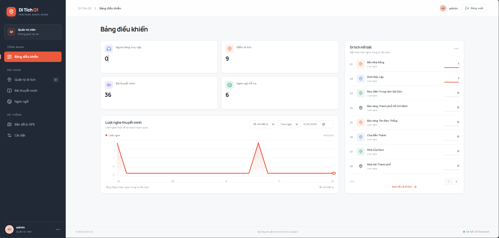
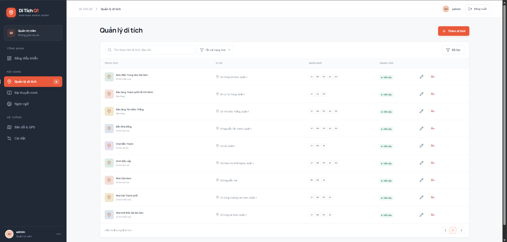
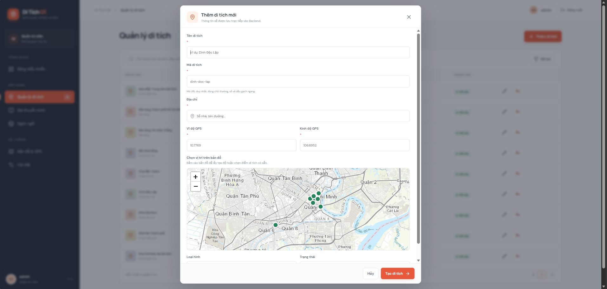
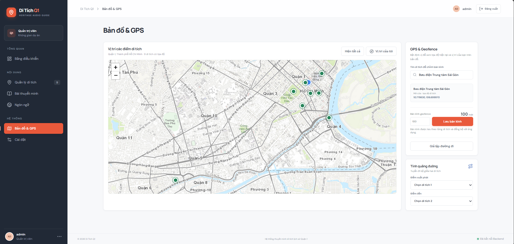
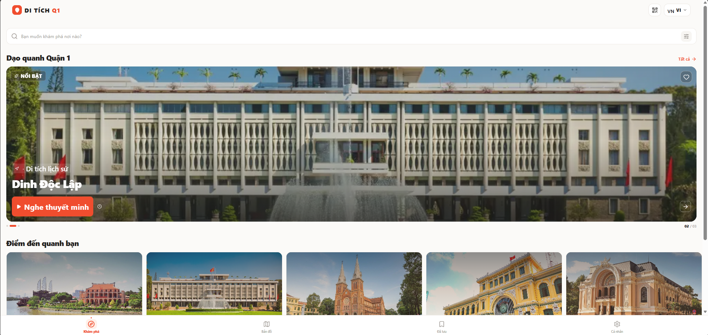
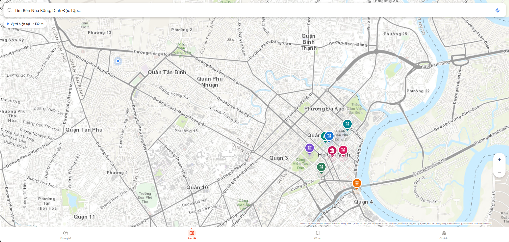
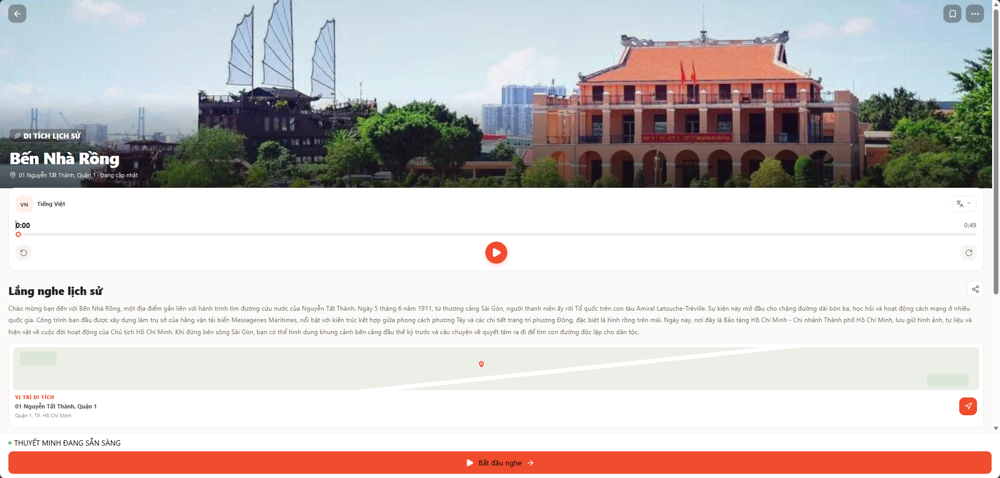

# Di Tích Q1

Di Tích Q1 là hệ thống hỗ trợ khám phá các di tích và địa điểm văn hóa tại Quận 1, Thành phố Hồ Chí Minh. Khách tham quan có thể xem địa điểm trên bản đồ, tìm nơi gần mình và nghe thuyết minh; trang quản trị cung cấp công cụ quản lý di tích, nội dung thuyết minh, ngôn ngữ và thống kê lượt nghe.

## Tài liệu dự án

- [Tài liệu yêu cầu sản phẩm (PRD)](./docs/PRD.pdf)
- [Sơ đồ Use Case](./docs/UseCase/)
- [Sơ đồ luồng dữ liệu (DFD)](./docs/DFD/)
- [Sơ đồ hoạt động](./docs/ActivityDiagram/)
- [Tài liệu cơ sở dữ liệu](./docs/database/)
- [Hướng dẫn triển khai và cấu hình Render](./HOSTING.md)

## Mục lục

- [Giới thiệu](#giới-thiệu)
- [Chức năng chính](#chức-năng-chính)
- [Ảnh giao diện](#ảnh-giao-diện)
- [Kiến trúc hệ thống](#kiến-trúc-hệ-thống)
- [Cấu trúc repository](#cấu-trúc-repository)
- [Công nghệ và yêu cầu](#công-nghệ-và-yêu-cầu)
- [Chạy thử](#chạy-thử)
- [API](#api)
- [Kiểm thử và CI/CD](#kiểm-thử-và-cicd)
- [Triển khai trực tuyến](#triển-khai-trực-tuyến)

## Giới thiệu

Ứng dụng hướng dẫn tham quan các điểm di tích tại Quận 1 bằng bản đồ và nội dung thuyết minh đa ngôn ngữ. Ứng dụng khách tham quan có thể sử dụng trên điện thoại hoặc trình duyệt; nhân viên quản trị sử dụng một website riêng để cập nhật dữ liệu và theo dõi hoạt động.

## Chức năng chính

### Ứng dụng khách tham quan

- Khám phá, tìm kiếm và xem thông tin các điểm tham quan trên bản đồ.
- Dùng vị trí GPS để tìm địa điểm gần đó và hỗ trợ phát thuyết minh khi đến gần di tích.
- Chọn ngôn ngữ giao diện và ngôn ngữ thuyết minh.
- Nghe nội dung audio, lưu địa điểm yêu thích và xem lại bộ sưu tập đã lưu.
- Xem chỉ đường đi bộ giữa các điểm tham quan.

### Website quản trị

- Đăng nhập và cập nhật thông tin tài khoản quản trị.
- Thêm, chỉnh sửa, ẩn/hiện và quản lý thông tin di tích, tọa độ GPS và bán kính geofence.
- Quản lý ngôn ngữ và bài thuyết minh theo từng di tích; tạo audio, nghe thử và quản lý trạng thái hiển thị.
- Xem lượt nghe, địa điểm được nghe nhiều, người truy cập hiện tại và hoạt động gần đây.
- Xem bản đồ di tích và tính tuyến đi bộ giữa các địa điểm.

### Backend

- Cung cấp API cho dữ liệu di tích, vị trí, ngôn ngữ, bài thuyết minh, lượt nghe và quản trị.
- Lưu dữ liệu trên MongoDB.
- Tách nghiệp vụ dữ liệu địa điểm/quản trị và dịch vụ dịch văn bản/tạo audio thành hai dịch vụ.

## Ảnh giao diện

### Admin

#### 1. Bảng điều khiển



#### 2. Quản lý di tích



#### 3. Thêm di tích



#### 4. Bản đồ và chỉnh bán kính geofence



### App khách tham quan

#### 1. Trang khám phá



#### 2. Bản đồ và định vị GPS



#### 3. Nghe thuyết minh



## Kiến trúc hệ thống

| Thành phần | Thư mục | Vai trò |
|---|---|---|
| Ứng dụng khách tham quan | `DoAn/FE/APP/thuyet-minh-app` | Ứng dụng React Native/Expo chạy trên Android, iOS và web |
| Website quản trị | `DoAn/FE/WEB/thuyet-minh-web` | SPA React dùng Vite để quản trị hệ thống |
| Site service | `DoAn/BE/site-service` | FastAPI xử lý di tích, xác thực quản trị, ngôn ngữ, lượt nghe và khách truy cập |
| Translation service | `DoAn/BE/translation-service` | FastAPI phục vụ nội dung dịch, audio thuyết minh và file âm thanh |
| MongoDB | Cấu hình qua `MONGO_URI` | Lưu dữ liệu hệ thống; cần cung cấp MongoDB riêng, Compose không khởi tạo database |

`DoAn/BE/api-gateway` cũng có mã nguồn trong repository, nhưng hiện không được khởi chạy trong `docker-compose.yml` hoặc cấu hình Render.

## Cấu trúc repository

```text
.
├── .github/
│   └── workflows/
│       └── ci-cd.yml                    # Kiểm thử, build và deploy Render
├── DoAn/
│   ├── BE/
│   │   ├── api-gateway/                 # API gateway (chưa được nối vào Compose/Render)
│   │   ├── site-service/                # API di tích và quản trị
│   │   ├── translation-service/         # API dịch và audio
│   │   └── docker-compose.yml           # Chạy hai backend service
│   └── FE/
│       ├── APP/thuyet-minh-app/         # Ứng dụng khách tham quan (Expo)
│       └── WEB/thuyet-minh-web/         # Website quản trị (React/Vite)
├── docs/
│   ├── ActivityDiagram/
│   ├── DFD/
│   ├── images/                          # Ảnh giao diện Admin và App dùng trong README
│   ├── UseCase/
│   ├── database/
│   └── PRD.pdf
├── HOSTING.md                           # Hướng dẫn cấu hình Render và GitHub Actions
├── render.yaml                          # Render Blueprint cho bốn dịch vụ
└── README.md
```

## Công nghệ và yêu cầu

- **Python 3.10** cho backend (đồng thời là phiên bản dùng trong CI).
- **Node.js 22+ và npm** để cài dependencies, chạy và build hai frontend.
- **MongoDB** truy cập được từ máy chạy backend; cấu hình bằng `MONGODB_URI`/`MONGO_URI`.
- **Docker Desktop với Docker Compose** nếu muốn khởi chạy hai backend trong container.
- **Expo Go hoặc Android/iOS simulator** nếu muốn thử ứng dụng di động.

## Chạy thử

### 1. Cấu hình và chạy backend

Tạo file `DoAn/BE/.env` với URI MongoDB của bạn. Có thể khai báo thêm khóa API nếu cần dùng chức năng tạo nội dung/audio. Không commit file `.env` hoặc khóa bí mật lên GitHub.

```dotenv
MONGODB_URI=mongodb://localhost:27017
MONGO_DATABASE=district1_historical_db
ADMIN_INITIAL_USERNAME=
ADMIN_INITIAL_PASSWORD=
DEEPSEEK_API_KEY=
AUDIO_PUBLIC_BASE_URL=http://localhost:8001
```

Điền `ADMIN_INITIAL_USERNAME` và `ADMIN_INITIAL_PASSWORD` bằng thông tin riêng trước khi khởi động nếu cần tạo tài khoản quản trị ban đầu. Nếu dùng MongoDB Atlas, thay `MONGODB_URI` bằng connection string phù hợp và cho phép máy chạy dịch vụ kết nối tới database.

Từ thư mục gốc repository, khởi động hai backend:

```powershell
docker compose --env-file DoAn\BE\.env -f DoAn\BE\docker-compose.yml up --build
```

- Site service: <http://localhost:8000> — tài liệu API tại <http://localhost:8000/docs>
- Translation service: <http://localhost:8001> — tài liệu API tại <http://localhost:8001/docs>

Compose chỉ chạy hai backend; MongoDB cần được cung cấp riêng. Dừng dịch vụ bằng `Ctrl+C`.

### 2. Chạy ứng dụng khách tham quan

Mở terminal tại `DoAn/FE/APP/thuyet-minh-app`:

```powershell
npm ci
npx expo start
```

Quét mã QR bằng Expo Go hoặc chọn simulator trong Expo. Để chạy giao diện web:

```powershell
npx expo start --web
```

Ứng dụng mặc định gọi site service ở cổng `8000` và translation service ở cổng `8001`. Khi chạy trên điện thoại thật, hãy đặt `EXPO_PUBLIC_API_URL` và `EXPO_PUBLIC_TRANSLATION_URL` thành địa chỉ IP LAN mà điện thoại truy cập được trước khi chạy Expo; đặt thêm `AUDIO_PUBLIC_BASE_URL` trong `DoAn/BE/.env` thành địa chỉ translation service đó để đường dẫn audio truy cập được từ điện thoại. Không dùng `localhost` cho địa chỉ backend trên điện thoại thật.

### 3. Chạy website quản trị

Khởi động backend trước, sau đó mở terminal tại `DoAn/FE/WEB/thuyet-minh-web`:

```powershell
npm ci
npm run dev
```

Mở địa chỉ Vite hiển thị trong terminal (thường là <http://localhost:5173>). Trong môi trường phát triển, Vite proxy `/api` và `/health` tới `http://127.0.0.1:8000`; có thể đổi đích proxy bằng biến `VITE_DEV_API_TARGET`.

Tài khoản quản trị ban đầu được cấu hình phía site service qua `ADMIN_INITIAL_USERNAME` và `ADMIN_INITIAL_PASSWORD`. Hãy thiết lập credentials riêng; không đưa thông tin đăng nhập vào README hoặc commit vào repository.

Mật khẩu quản trị hết hạn sau 24 giờ kể từ lần đổi gần nhất. Khi hết hạn, Admin chỉ được đổi mật khẩu trước khi sử dụng các chức năng quản trị. Với tài khoản đã tồn tại, hệ thống khởi tạo mốc `password_changed_at` ở lần site service khởi động đầu tiên sau khi cập nhật.

## API

Hai dịch vụ backend được xây dựng bằng FastAPI và cung cấp Swagger UI tại đường dẫn `/docs` khi chạy cục bộ.

- **Site service** (`:8000`): di tích, xác thực quản trị, quản lý ngôn ngữ và bài thuyết minh, vị trí GPS, lượt nghe và thống kê.
- **Translation service** (`:8001`): xử lý bài thuyết minh/audio và phục vụ file âm thanh.
- Cả hai dịch vụ cung cấp endpoint kiểm tra trạng thái tại `/health`.

## Kiểm thử và CI/CD

GitHub Actions được cấu hình trong [`.github/workflows/ci-cd.yml`](./.github/workflows/ci-cd.yml):

- Kiểm tra cú pháp Python và chạy các bài test backend được chọn.
- Cài dependencies và build ứng dụng khách tham quan cho web cùng website quản trị.
- Sau khi CI thành công trên nhánh `main`, gọi deploy hooks của bốn dịch vụ Render. Pull request chạy kiểm tra nhưng không deploy.

Chạy các bài test backend tại máy:

```powershell
Set-Location DoAn\BE\site-service
python -m pip install -r requirements.txt
python -m pip install pytest
python -m pytest -q

Set-Location ..\translation-service
python -m pip install -r requirements.txt
python -m pytest -q
```

Chạy test frontend trong thư mục tương ứng:

```powershell
npm ci
npm test
```

Build riêng website quản trị bằng `npm run build`; build bản web của ứng dụng Expo bằng `npx expo export --platform web`.

## Triển khai trực tuyến

Render Blueprint trong [`render.yaml`](./render.yaml) định nghĩa hai backend và hai frontend. Cấu hình MongoDB, khóa API và deploy hooks theo hướng dẫn tại [HOSTING.md](./HOSTING.md).

- Ứng dụng khách tham quan: <https://quan1-web-4pxd.onrender.com>
- Website quản trị: <https://quan1-admin.onrender.com>
- Site service: <https://quan1-site-service-a1vt.onrender.com>
- Translation service: <https://quan1-translation-service-d3xw.onrender.com>

Các dịch vụ Render gói miễn phí có thể tạm ngừng khi không hoạt động; request đầu tiên sau thời gian chờ có thể mất thêm thời gian để khởi động.

## Thành viên nhóm

| STT | MSSV | Họ và tên |
|---:|---|---|
| 1 | 3124411178 | [HỨA KIM NGÂN](https://www.facebook.com/kimngan.hua.948) |
| 2 | 3124411006 | [ĐẶNG NGỌC MINH ANH](https://www.facebook.com/minh.anh.ang.349580) |
| 3 | 3124411200 | [QUÁCH MINH NHẬT](https://www.facebook.com/nhat.quach.minh.2024?locale=vi_VN) |
